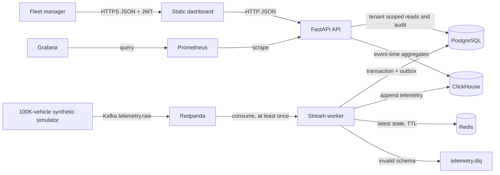
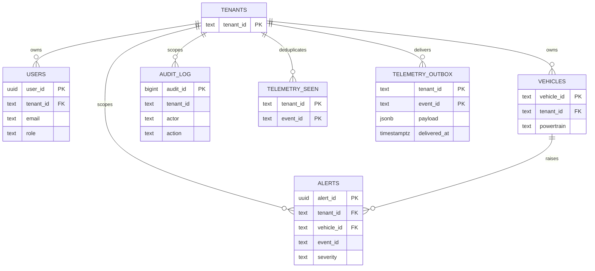

# Architecture and data flow

## Context and containers

The fleet manager uses the browser UI and a JWT-secured API. The simulator stands in for an OEM cloud. Redpanda preserves the raw event stream for replay. A worker applies OEM adapter mapping and validation, computes an explainable maintenance risk score, and writes operational data plus an outbox row in one PostgreSQL transaction. It writes the analytical row to ClickHouse, marks the outbox delivered, then commits the Kafka offset. A failed sink write leaves the Kafka offset uncommitted and retries the event. Invalid events are directed to a dead-letter topic.

The dashboard reads vehicle and alert data from PostgreSQL; analytics reads event-time buckets from ClickHouse. Tenant ID comes from verified JWT claims, never from a query parameter. PostgreSQL is the consistency boundary for ownership, alert state and audit events (CP preference). Kafka and ClickHouse favor durable availability and eventual analytics (AP preference). Redis is disposable and may be rebuilt from later events.

## Data volume model

Reference scenario: 100,000 vehicles × 1 event/s × 1 KB/event = 100,000 events/s, about 8.64 TB/day and 3.15 PB/year before compression, filtering and downsampling. These are case-study estimates, not local benchmark results. Partition ClickHouse by event month, order by tenant/vehicle/time/event, and partition Kafka by vehicle ID to keep a vehicle's event order within a partition. At 100K events/s, use Kafka partitions and workers sized through load tests; the local Compose configuration is only a functional demo.

Hot relational state consists of tenants, users, vehicles, alerts and audit rows. Telemetry is append-oriented in ClickHouse with a 90-day demo retention. Redis caches latest state for one hour. Export to S3/Parquet for cold retention is a deployment extension; it is not implemented in this local prototype. The architecture avoids claiming a cold-tier lifecycle that the code does not yet provide.

## ER sketch

This is the 3NF operational core. `telemetry_seen` and the transactional outbox are intentionally keyed by `(tenant_id,event_id)` for idempotency. ClickHouse denormalizes telemetry fields to avoid joins in time-range analytics.
